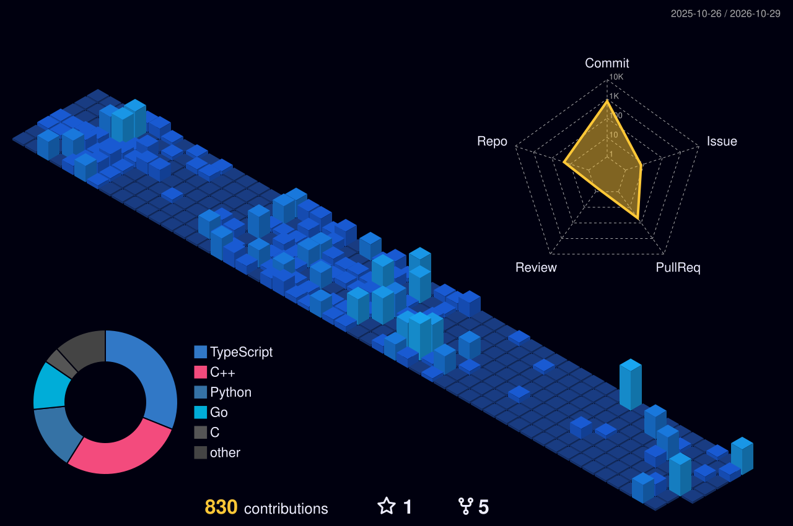

  

    

  

  

  

    Hi, I'm <b>Made Branenda Jordhy</b> — an Informatics student at <b>Institut Teknologi Bandung (ITB)</b>. 
    I build backend systems, full-stack applications, and deployment pipelines, with a growing focus on <b>applied Artificial Intelligence</b>. Currently working on industrial maintenance software, cloud infrastructure, and helping student teams ship better software.
  

  

 

### Education

- **Institut Teknologi Bandung** — B.E. in Informatics Engineering, Aug 2024–present. GPA: **3.79 / 4.00**.
- **Member of HMIF ITB & IEEE ITB Student Branch.**

 

### Awards

- **Top 20 — AI Innovation Challenge, COMPFEST 18 (2026)** — Built **[SIENA](https://github.com/MichaelJamesL/aic-compfest-26)**, a predictive-maintenance platform combining sensor anomaly detection, pgvector RAG, and a MobileNetV3 defect classifier with human-approved work orders.
- **Semifinalist — AI Open Innovation Challenge, President University (July 2026)** — Built **JakaLink**, an AI-powered transit platform with multimodal trip planning, ETA and crowding forecasts, and live rerouting.
- **2nd Place — Hackfest 2026, Ciputra University (April 2026)** — Built **[CarbonLink](https://github.com/ethj0r/WorkLifeBalance)**, a carbon-credit verification platform for smallholder agroforestry using aerial tree detection, NDVI, and carbon estimation.

 

### Experience

- **Software Engineering Laboratory Assistant — STEI ITB** · Aug 2026–present. Mentor IF2150 teams through requirements, UML design, implementation, testing, and collaborative Git workflows.
- **DevOps Engineer (Technology Development) — Inkubator IT** · May 2026–present. Build CI/CD pipelines with GitHub Actions and Docker, operate applications on Cloudflare, and integrate AWS SES for transactional email.
- **Software Engineer — Concorde Systems** · May 2026–present. Own backend development for ConcordeOS, an offline-first industrial maintenance platform, using Go, Chi, sqlc, and Supabase; design APIs, authentication, and synchronization.

 

### Leadership & Activities

- **Director of Technology — The Sandbox 3.0** · Nov 2025–May 2026. Led a competition platform for **400+ users**, including registration, multi-stage submissions, and an internal verification dashboard.
- **Software Engineering Curriculum Developer — Arkavidia** · May 2026–present. Design hands-on sessions on backend architecture, API integration, and production deployment.
- **Full-Stack Developer — TEDxITB 9.0** · Nov 2025–May 2026. Built registration and content-discovery flows, API integrations, database logic, and responsive interfaces.
- **Full-Stack Developer — IEEE ITB Student Branch** · Aug 2025–June 2026. Engineered IEEE Paper Explorer, a pipeline that fetches, processes, and displays live research-paper data from the IEEE API.

 

### Featured Projects

#### AI & Intelligent Systems

- **[Eigen Pustaka](https://github.com/ethj0r/IF2123-Geometric-and-Linear-Algebra-EIGENPUSTAKA)** — Book discovery engine with TF-IDF + LSA text search, PCA image search, and personalized recommendations. Linear algebra implemented from scratch, served through Next.js and FastAPI.

#### Algorithms & Visualization

- **[domTraverse](https://github.com/ethj0r/Tubes2_PengenLibur_FE)** — DOM traversal visualizer with animated BFS/DFS, a custom CSS-selector engine, and Lowest Common Ancestor computation. Built with Next.js and Go, Dockerized on Azure.
- **[VeilGuard](https://github.com/ethj0r/Tubes3_LeGamblers)** — Chromium extension that detects online gambling content in the live DOM using hand-implemented Knuth–Morris–Pratt and Boyer–Moore string-matching algorithms.

#### Software & Systems

- **Source, please?** — Real-time multiplayer media-literacy game built for UNESCO Youth Hackathon 2026. Uses a server-clocked round engine on Cloudflare Durable Objects, PartyServer WebSockets, and Supabase for authentication, EXP, and leaderboards.
- **[YAREU](https://github.com/ethj0r/IF2150-Software-Engineering-YAREU)** — Sustainability platform unifying buy/sell, donations, and trade-in workflows, built with Python, Flet, PostgreSQL, and modular MVC architecture.

 

  

 

  

 

### Connect

  
  &nbsp;&nbsp;&nbsp;
  
  &nbsp;&nbsp;&nbsp;
  

