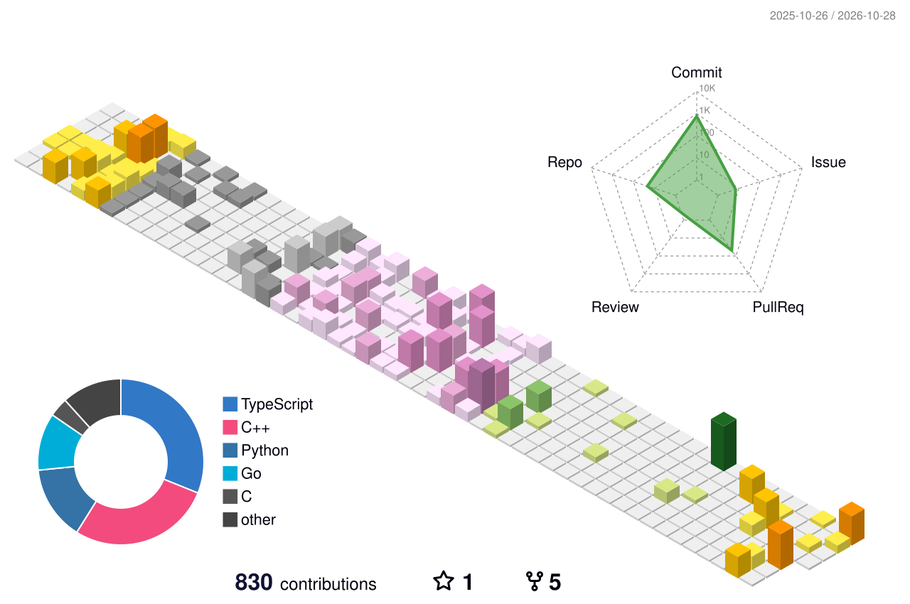

  <h1>Hi, Jordhy here 👋🏻</h1>

  
Computer Science Undergraduate @ <b>Institut Teknologi Bandung</b>

  

    <b>Learning relentlessly. Building intentionally.</b> 
    Interested in data science, machine learning, and software engineering. 
  

   

  <a href="https://ethjor.tech"><b>Explore my work ↗</b></a>
  &nbsp;·&nbsp;
  <a href="https://ethjor.tech/resume.pdf">Résumé ↗</a>

 

---

### Awards

- **Top 20 — AI Innovation Challenge, COMPFEST 18 (2026)** — Built **[SIENA](https://github.com/MichaelJamesL/aic-compfest-26)**, a predictive-maintenance platform combining sensor anomaly detection, pgvector RAG, and a MobileNetV3 defect classifier with human-approved work orders.
- **Semifinalist — AI Open Innovation Challenge, President University (July 2026)** — Built **JakaLink**, an AI-powered transit platform with multimodal trip planning, ETA and crowding forecasts, and live rerouting.
- **2nd Place — Hackfest 2026, Ciputra University (April 2026)** — Built **[CarbonLink](https://github.com/ethj0r/WorkLifeBalance)**, a carbon-credit verification platform for smallholder agroforestry using aerial tree detection, NDVI, and carbon estimation.

 

### Featured Projects

#### AI & Intelligent Systems

- **[Sietch](https://github.com/ethj0r/sietch)** — Internship discovery and application tracker with CV matching, evidence-checked résumé tailoring, and cover-letter generation. Built with React, TypeScript, Cloudflare Workers, D1, and Workers AI.
- **[Eigen Pustaka](https://github.com/ethj0r/IF2123-Geometric-and-Linear-Algebra-EIGENPUSTAKA)** — Book discovery engine with TF-IDF + LSA text search, PCA image search, and personalized recommendations. Linear algebra implemented from scratch, served through Next.js and FastAPI.
- **[Clearo](https://github.com/ethj0r/Clearo)** — Pomodoro productivity app with webcam-based distraction detection using TensorFlow.js and COCO-SSD, plus points, streaks, and session history. React, Express, and PostgreSQL. [Live demo ↗](https://clearo-by-ethjor.vercel.app)
- **[3D Packing Optimizer](https://github.com/ethj0r/IF3170_G06_JensensLeatherJackets)** — Package-placement optimization using hill climbing, simulated annealing, and genetic algorithms, with a Streamlit interface for 3D visualization and experiment comparison.
- **[Battlecode 2025 Bots](https://github.com/ethj0r/Tubes1_opentowork)** — Three Java strategy bots exploring economy-first, paint-first, and nearest-first greedy policies, with Bug2 navigation and inter-unit communication in the main bot.
- **[CarbonLink](https://github.com/ethj0r/WorkLifeBalance)** — Carbon-credit MRV platform for Indonesian agroforestry, combining DeepForest tree detection, NDVI, polygon mapping, and carbon estimation through Next.js and FastAPI.

#### Algorithms & Visualization

- **[domTraverse](https://github.com/ethj0r/Tubes2_PengenLibur_FE)** — DOM traversal visualizer with animated BFS/DFS, a custom CSS-selector engine, and Lowest Common Ancestor computation. Built with Next.js and Go, Dockerized on Azure. [Backend ↗](https://github.com/ethj0r/Tubes2_PengenLibur_BE)
- **[VeilGuard](https://github.com/ethj0r/Tubes3_LeGamblers)** — Chromium extension that detects online gambling content in the live DOM using hand-implemented Knuth–Morris–Pratt and Boyer–Moore string-matching algorithms.
- **[Voxelith](https://github.com/ethj0r/Tucil2_13524026_13524104)** — C++17 mesh-to-voxel converter using recursive octree subdivision and empty-region pruning, with OBJ import/export and raylib visualization.
- **[Ice Sliding Puzzle Solver](https://github.com/jenka-h/Tucil3_13524026_1354110)** — C++ pathfinding solver comparing UCS, greedy best-first search, and A* with five heuristics and a raylib interface for step-by-step visualization.
- **[Queens](https://github.com/ethj0r/Tucil1_13524026)** — Pure brute-force solver for LinkedIn's Queens puzzle, with a Go/Fyne desktop interface, CLI mode, and solution-image export.
- **[Matrix Calculator](https://github.com/ethj0r/IF2123-Geometric-and-Linear-Algebra-MATRIX-CALCULATOR)** — JavaFX desktop toolkit for linear systems, determinants, inverses, interpolation, polynomial regression, and seamless image cloning through Poisson image editing.

#### Software & Systems

- **[PostgreSQL Management Platform](https://github.com/ethj0r/IF3110-K02-01)** — Go and React workspace for database inspection, transactional migrations, schema comparison, and query-plan analysis, with group-based access and encrypted connection management.
- **[Arion Compiler](https://github.com/ethj0r/IF2224-TBFO-Arion_Compiler)** — C++ compiler-interpreter for a Pascal-like language, covering lexical and syntax analysis, type checking, stack-machine code generation, and execution on a custom virtual machine.
- **[GRODDIT](https://github.com/ethj0r/IF2110-Algorithm-and-Programming-II-GRODDIT)** — Terminal-based social platform in C with nested discussions, voting, heap-based feeds, trie-based search, and graph-based friend recommendations.
- **Source, please?** — Real-time multiplayer media-literacy game built for UNESCO Youth Hackathon 2026. Uses a server-clocked round engine on Cloudflare Durable Objects, PartyServer WebSockets, and Supabase for authentication, EXP, and leaderboards.
- **[YAREU](https://github.com/ethj0r/IF2150-Software-Engineering-YAREU)** — Sustainability platform unifying buy/sell, donations, and trade-in workflows, built with Python, Flet, PostgreSQL, and modular MVC architecture.

 

  

 

---

 

### Connect

  
  &nbsp;&nbsp;&nbsp;
  
  &nbsp;&nbsp;&nbsp;
  

